```mermaid
flowchart LR
    subgraph P[" PROVISION "]
        TF["Terraform"] --> CLOUD["Azure · AWS"]
    end
    subgraph B[" BUILD & SECURE "]
        GH["GitHub Actions"] --> SCAN["Trivy scan"] --> REG["ACR · GHCR"]
    end
    subgraph D[" DEPLOY "]
        ARGO["ArgoCD · kubectl"] --> K8S["AKS · Kubernetes"]
    end
    subgraph O[" OBSERVE "]
        PROM["Prometheus"] --> GRAF["Grafana"]
    end
    CLOUD --> GH
    REG --> ARGO
    K8S --> PROM

    classDef iac fill:#7B42BC,color:#fff,stroke:none
    classDef ci fill:#2088FF,color:#fff,stroke:none
    classDef sec fill:#1F883D,color:#fff,stroke:none
    classDef k8s fill:#326CE5,color:#fff,stroke:none
    classDef obs fill:#E6522C,color:#fff,stroke:none
    class TF,CLOUD iac
    class GH,REG ci
    class SCAN sec
    class ARGO,K8S k8s
    class PROM,GRAF obs
```

<div align="center">

<br>

# Aniket Kumar

### DevOps Engineer

*I make infrastructure boring in the right way.*

<br>


<br><br>

[Projects](#projects) &nbsp;·&nbsp; [How I Ship](#how-i-ship) &nbsp;·&nbsp; [Experience](#experience) &nbsp;·&nbsp; [Contact](#lets-talk)
<div align="center">

<br>

# Aniket Kumar

### DevOps Engineer

*I make infrastructure boring in the right way.*

Azure &nbsp;·&nbsp; AWS &nbsp;·&nbsp; Terraform &nbsp;·&nbsp; Kubernetes &nbsp;·&nbsp; CI/CD &nbsp;·&nbsp; GitOps &nbsp;·&nbsp; DevSecOps

<br>


<br><br>

[](#featured-projects)
&nbsp;
[](https://linkedin.com/in/aniket484)

<br>

**Open to DevOps / Cloud Engineer roles** &nbsp;·&nbsp; Bengaluru or remote &nbsp;·&nbsp; Full-time

<br>

</div>

---

## GitHub Activity

<div align="center">

<table>
<tr>
<td valign="top">

</td>
<td valign="top">

</td>
</tr>
</table>

</div>

---

## About

DevOps Engineer with **2 years** of hands-on experience across Azure infrastructure, Terraform, CI/CD automation, containerized deployments, Kubernetes, and DevSecOps.

My day job is Azure and pipelines. My own time goes into projects I build to actually run, not just to demo, because I'd rather find out where a design breaks on my own dime than on a client's.

> No manual clicks. No "it works on my machine." Everything reproducible, everything in code.

| | |
|---|---|
| **Now** | DevOps Engineer @ DevOps Insiders |
| **Strongest at** | Azure infrastructure, Terraform, CI/CD pipelines |
| **Also building with** | AWS, ArgoCD, Prometheus, Grafana |
| **Education** | BCA, Chandigarh Group of Colleges, Mohali |
| **Based in** | Bengaluru, Karnataka, India |

---

## How I Ship



<sub>Every stage above is something I have built and run in the projects below.</sub>

---

## Featured Projects

<div align="center">

| | Project | Platform | Highlights |
|:-:|---|---|---|
| ⭐ | [**Axion Intelligence Platform**](#axion-intelligence-platform) | Azure AKS | Terraform, GitHub Actions, FastAPI, React |
| 🔁 | [**GitOps CI/CD Pipeline**](#gitops-cicd-pipeline) | Kind (local) | Trivy gate, GHCR, Helm, ArgoCD |
| 🛡️ | [**Azure Network Foundation**](#azure-network-foundation) | Azure | Hub-and-spoke, Firewall, Bastion, Key Vault |
| ☁️ | [**AWS Landing Network**](#aws-landing-network) | AWS | Multi-AZ VPC, ALB, remote state |
| 📈 | [**Airflow Observability Pipeline**](#airflow-observability-pipeline) | Docker Compose | StatsD, Prometheus, Grafana |

</div>

<br>

### Axion Intelligence Platform

  

**An industrial IoT monitoring platform running on a live AKS cluster.** 27 simulated assets (pumps, motors, compressors) across five refinery sites stream temperature, vibration, and current readings every 5 seconds into a dashboard with 3D digital twins and real-time health scoring.

| Platform | Delivery flow | Demonstrates |
|---|---|---|
| Azure AKS + ACR | Terraform → GitHub Actions → ACR → AKS → LoadBalancer | End-to-end IaC and Kubernetes delivery |


<p align="center">
  <a href="https://raw.githubusercontent.com/aniket-devop/axion-cloud-infrastructure/main/docs/architecture.png">
    
  </a>
</p>

- Ingestion and query split into separate services so each scales independently
- One Terraform module tree renders dev/staging/prod through `for_each` over an `environments` map
- Remote state bootstrapped in a separate stack; ACR runs with `admin_enabled = false`

<sub>**Honest scope:** portfolio build with documented gaps (inline DB credentials, `emptyDir` storage, no Ingress/TLS yet), all listed in the repo roadmap.</sub>

**[Repository →](https://github.com/aniket-devop/axion-cloud-infrastructure)** &nbsp;·&nbsp; **[Watch the deployment demo →](https://github.com/aniket-devop/axion-cloud-infrastructure/raw/main/docs/demo/axion-deployment-demo.mp4)**

<br>

### GitOps CI/CD Pipeline

  

**Two repos, one boundary: CI never touches the cluster.** The app repo builds, tests, scans, and publishes an image. The config repo holds the desired state that ArgoCD reconciles.

| Platform | Delivery flow | Demonstrates |
|---|---|---|
| Kind (local cluster) | pytest → Docker build → Trivy CRITICAL → GHCR → Git commit → ArgoCD | GitOps separation, DevSecOps gating, Git-only rollback |


<br>
<sub>Also: Trivy · GHCR · Helm · ArgoCD · Kind</sub>

<p align="center">
  <a href="https://raw.githubusercontent.com/aniket-devop/gitops-kubernetes-config/main/screenshots/architecture-diagram.png">
    
  </a>
</p>

- Trivy CRITICAL gate hard-fails the pipeline before an image reaches GHCR
- Non-root container on a minimal `python:3.12-alpine` base
- Rollback is a pure Git operation: reverting the image-tag commit lets ArgoCD `selfHeal` restore the previous version

<sub>**Honest scope:** runs on a local Kind cluster. Only `dev` is fully automated; `staging` is manual sync.</sub>

**[App repo →](https://github.com/aniket-devop/gitops-ci-pipeline)** &nbsp;·&nbsp; **[GitOps repo →](https://github.com/aniket-devop/gitops-kubernetes-config)**

<br>

### Azure Network Foundation

  

**A hub-and-spoke Azure network built entirely in Terraform**, with egress forced through the Firewall and an RBAC-authorized Key Vault. Deployable to `dev` and `prod` from one DRY configuration.

| Platform | Topology | Demonstrates |
|---|---|---|
| Azure | Hub VNet (Firewall + Bastion) → Spoke VNet (NSG + AKS subnet) → Key Vault | Network security design and least-privilege RBAC |


<br>
<sub>Also: Azure Firewall · Bastion · Key Vault · Azure RBAC</sub>

<p align="center">
  <a href="https://raw.githubusercontent.com/aniket-devop/azure-network-foundation-terraform/main/diagrams/architecture.png">
    
  </a>
</p>

- RBAC scoped to the resource group, not the subscription, to limit blast radius
- Explicit `DenyAllInbound` rule instead of relying on platform defaults
- Bastion instead of a jump box, so no VM carries a public IP

<sub>**Honest scope:** sandbox-scale project, not a full Cloud Adoption Framework landing zone. CI runs `fmt`, `init`, and `validate` only.</sub>

**[Repository →](https://github.com/aniket-devop/azure-network-foundation-terraform)**

<br>

### AWS Landing Network

 

**The same private-compute pattern, rebuilt in AWS.** One VPC across two AZs, ALB-fronted EC2 in private subnets, outbound-only access through a NAT Gateway, and Terraform state stored remotely in S3 with DynamoDB locking.

| Platform | Traffic path | Demonstrates |
|---|---|---|
| AWS (VPC `10.0.0.0/16`, 2 AZs) | Internet → ALB (public) → EC2 (private) → NAT Gateway | The same design pattern carried across clouds |


<br>
<sub>Also: VPC · EC2 · ALB · IAM · S3 · DynamoDB</sub>

<p align="center">
  <a href="https://raw.githubusercontent.com/aniket-devop/aws-terraform-landing-zone-project/main/diagrams/architecture.png">
    
  </a>
</p>

- EC2 security groups accept traffic only from the ALB
- Every PR runs `terraform fmt -check` → `validate` → `plan` through GitHub Actions

<sub>**Honest scope:** self-driven hands-on project. Azure is my primary professional cloud.</sub>

**[Repository →](https://github.com/aniket-devop/aws-terraform-landing-zone-project)**

<br>

### Airflow Observability Pipeline

 

**A containerized Airflow deployment with a full metrics pipeline.** Re-architected from Airflow's official CeleryExecutor/Redis template into a single-node LocalExecutor + PostgreSQL setup, started with one `docker compose up`.

| Platform | Metrics flow | Demonstrates |
|---|---|---|
| Docker Compose (single node) | Airflow → StatsD Exporter → Prometheus (15s scrape) → Grafana | Observability design and right-sizing architecture |


<br>
<sub>Also: Docker Compose · Apache Airflow · StatsD</sub>

<p align="center">
  <a href="https://raw.githubusercontent.com/aniket-devop/airflow-docker-grafana-monitoring/main/assets/architecture-diagram.png">
    
  </a>
</p>

- Dropped the message broker and worker fleet that add no value at single-node scale
- StatsD Exporter bridges Airflow metrics into Prometheus, since Airflow exposes no native `/metrics` endpoint in this setup

<sub>**Honest scope:** working single-node deployment with a verified metrics pipeline. No pre-provisioned dashboards or alerting.</sub>

**[Repository →](https://github.com/aniket-devop/airflow-docker-grafana-monitoring)**

---

## Tech Stack

<div align="center">

| Domain | Tools |
|:-:|:-:|
| **Cloud** |  |
| **IaC & CI/CD** |  |
| **Containers** |  |
| **Monitoring** |  |
| **Languages & OS** |  |

</div>

<br>

Also working with: **Azure DevOps Pipelines · AKS · Helm · ArgoCD · Trivy · TFLint · TFSec · Checkov · FastAPI · PostgreSQL**

---

## Experience

**DevOps Engineer · DevOps Insiders**

- Provision and manage Azure infrastructure with Terraform: resource groups, virtual networks, and AKS
- Build and maintain CI/CD pipelines with GitHub Actions and Azure DevOps Pipelines
- Containerize applications with Docker and deploy to Kubernetes/AKS using Helm
- Apply DevSecOps practices by integrating security and IaC scanning into the delivery lifecycle
- Set up monitoring and observability with Prometheus and Grafana
- Troubleshoot pipeline, infrastructure, and deployment issues across environments

**Education:** BCA, Chandigarh Group of Colleges, Mohali

---

## Let's Talk

I'm open to **DevOps / Cloud Engineer** roles, full-time, in Bengaluru or remote. If something here fits a role you're hiring for, or you want to compare notes on Terraform module design, AKS networking, or GitOps patterns, reach out.

<div align="center">

<br>

[](https://linkedin.com/in/aniket484)

<br>

<sub>Built to run. Documented to be understood.</sub>

</div>
</div>

<br>

```diff
$ terraform plan -out=aniket.tfplan

+ resource "engineer" "aniket_kumar" {
+   role           = "DevOps Engineer"
+   experience     = "2 years"
+   clouds         = ["Azure (primary)", "AWS"]
+   iac            = "Terraform"
+   orchestration  = ["Kubernetes", "AKS", "Helm", "ArgoCD"]
+   pipelines      = ["GitHub Actions", "Azure DevOps"]
+   secures_with   = ["Trivy", "TFLint", "TFSec", "Checkov"]
+   observes_with  = ["Prometheus", "Grafana"]
+   based_in       = "Bengaluru, India"
+   open_to_work   = true
+ }

Plan: 1 to add, 0 to change, 0 to destroy.
```

> No manual clicks. No "it works on my machine." Everything reproducible, everything in code.

---

## How I Ship


<sub>Every stage above is something I have built and run in the projects below.</sub>

---

## Projects

Five projects, each one built to actually run. Every card lists what it demonstrates and what it deliberately leaves out.

<br>

### Axion Intelligence Platform

  

**An industrial IoT monitoring platform running on a live AKS cluster.** 27 simulated assets (pumps, motors, compressors) across five refinery sites stream temperature, vibration, and current readings every 5 seconds into a dashboard with 3D digital twins and real-time health scoring.

| Platform | Delivery flow | Demonstrates |
|---|---|---|
| Azure AKS + ACR | Terraform → GitHub Actions → ACR → AKS → LoadBalancer | End-to-end IaC and Kubernetes delivery |


<p align="center">
  <a href="https://raw.githubusercontent.com/aniket-devop/axion-cloud-infrastructure/main/docs/architecture.png">
    
  </a>
</p>

<details>
<summary><b>Engineering decisions and documented gaps</b></summary>
<br>

**Decisions**
- Ingestion (write-heavy) and query (aggregation + health scoring) split into separate services so each scales independently
- One Terraform module tree renders dev/staging/prod through `for_each` over an `environments` map
- Remote state bootstrapped in a separate `state-infrastructure/` stack to solve the backend chicken-and-egg problem
- `admin_enabled = false` on ACR, forcing identity-based auth over shared admin credentials

**Documented gaps**
- Database credentials are inline rather than Key Vault-backed Secrets
- Storage uses `emptyDir` instead of a PersistentVolumeClaim
- No Ingress/TLS yet

</details>

**[Repository →](https://github.com/aniket-devop/axion-cloud-infrastructure)** &nbsp;·&nbsp; **[Watch the deployment demo →](https://github.com/aniket-devop/axion-cloud-infrastructure/raw/main/docs/demo/axion-deployment-demo.mp4)**

<br>

### GitOps CI/CD Pipeline

  

**Two repos, one boundary: CI never touches the cluster.** The app repo builds, tests, scans, and publishes an image. The config repo holds the desired state that ArgoCD reconciles.

| Platform | Delivery flow | Demonstrates |
|---|---|---|
| Kind (local cluster) | pytest → Docker build → Trivy CRITICAL → GHCR → Git commit → ArgoCD | GitOps separation, DevSecOps gating, Git-only rollback |


<br>
<sub>Also: Trivy · GHCR · Helm · ArgoCD · Kind</sub>

<p align="center">
  <a href="https://raw.githubusercontent.com/aniket-devop/gitops-kubernetes-config/main/screenshots/architecture-diagram.png">
    
  </a>
</p>

<details>
<summary><b>Engineering decisions and documented gaps</b></summary>
<br>

**Decisions**
- Trivy CRITICAL gate hard-fails the job before an image reaches GHCR
- Non-root container (`appuser`) on a minimal `python:3.12-alpine` base
- Two separately scoped credentials (`GITHUB_TOKEN` for GHCR, a distinct token for the cross-repo commit), so neither can touch the cluster
- Rollback is a pure Git operation: a `git revert` on the image-tag commit lets ArgoCD `selfHeal` restore the previous version

**Documented gaps**
- Runs on a local Kind cluster, not managed cloud Kubernetes
- Only `dev` is fully automated; `staging` is manual sync with no promotion path yet

</details>

**[App repo →](https://github.com/aniket-devop/gitops-ci-pipeline)** &nbsp;·&nbsp; **[GitOps repo →](https://github.com/aniket-devop/gitops-kubernetes-config)**

<br>

### Azure Network Foundation

  

**A hub-and-spoke Azure network built entirely in Terraform**, with egress forced through the Firewall and an RBAC-authorized Key Vault. Deployable to `dev` and `prod` from one DRY configuration.

| Platform | Topology | Demonstrates |
|---|---|---|
| Azure | Hub VNet (Firewall + Bastion) → Spoke VNet (NSG + AKS subnet) → Key Vault | Network security design and least-privilege RBAC |


<br>
<sub>Also: Azure Firewall · Bastion · Key Vault · Azure RBAC</sub>

<p align="center">
  <a href="https://raw.githubusercontent.com/aniket-devop/azure-network-foundation-terraform/main/diagrams/architecture.png">
    
  </a>
</p>

<details>
<summary><b>Engineering decisions and documented gaps</b></summary>
<br>

**Decisions**
- RBAC scoped to the resource group, not the subscription, to limit blast radius
- Explicit `DenyAllInbound` NSG rule instead of relying on Azure's implicit defaults
- Azure Bastion instead of a jump box, so no VM in the design carries a public IP
- Route table forces all egress from the AKS subnet through the Firewall's private IP
- Key Vault secured with RBAC + network ACL rather than a Private Endpoint, a deliberate documented trade-off

**Documented gaps**
- Sandbox-scale, not a Cloud Adoption Framework landing zone (no management groups, no Azure Policy)
- CI runs `fmt -check`, `init -backend=false`, and `validate` only; no `plan`/`apply` automation or security scanning yet
- No compute deployed yet

</details>

**[Repository →](https://github.com/aniket-devop/azure-network-foundation-terraform)**

<br>

### AWS Landing Network

 

**The same private-compute pattern, rebuilt in AWS.** One VPC across two AZs, ALB-fronted EC2 in private subnets, outbound-only access through a NAT Gateway, and Terraform state stored remotely in S3 with DynamoDB locking.

| Platform | Traffic path | Demonstrates |
|---|---|---|
| AWS (VPC `10.0.0.0/16`, 2 AZs) | Internet → ALB (public) → EC2 (private) → NAT Gateway | Cloud portability of the same design pattern |


<br>
<sub>Also: VPC · EC2 · ALB · IAM · S3 · DynamoDB</sub>

<p align="center">
  <a href="https://raw.githubusercontent.com/aniket-devop/aws-terraform-landing-zone-project/main/diagrams/architecture.png">
    
  </a>
</p>

<details>
<summary><b>Engineering decisions and next steps</b></summary>
<br>

**Decisions**
- EC2 security groups accept traffic only from the ALB
- Internet Gateway reaches the public subnets only; private compute goes out through the NAT Gateway
- Every PR runs `terraform fmt -check` → `validate` → `plan` through GitHub Actions

**Scope and next steps**
- Self-driven hands-on project; Azure is my primary professional cloud
- Planned: HTTPS listener with ACM, Auto Scaling Group, CloudWatch alarms and dashboard

</details>

**[Repository →](https://github.com/aniket-devop/aws-terraform-landing-zone-project)**

<br>

### Airflow Observability Pipeline

 

**A containerized Airflow deployment with a full metrics pipeline.** Re-architected from Airflow's official CeleryExecutor/Redis template into a single-node LocalExecutor + PostgreSQL setup, started with one `docker compose up`.

| Platform | Metrics flow | Demonstrates |
|---|---|---|
| Docker Compose (single node) | Airflow → StatsD Exporter → Prometheus (15s scrape) → Grafana | Observability design and right-sizing architecture |


<br>
<sub>Also: Docker Compose · Apache Airflow · StatsD</sub>

<p align="center">
  <a href="https://raw.githubusercontent.com/aniket-devop/airflow-docker-grafana-monitoring/main/assets/architecture-diagram.png">
    
  </a>
</p>

<details>
<summary><b>Engineering decisions and documented gaps</b></summary>
<br>

**Decisions**
- Replaced CeleryExecutor + Redis with LocalExecutor, removing a message broker and worker fleet that add no benefit at single-node scale, while keeping health checks, dependency ordering, and persistent metadata storage
- StatsD Exporter bridges Airflow metrics into Prometheus format, since Airflow exposes no native `/metrics` endpoint in this configuration

**Documented gaps**
- No pre-provisioned Grafana dashboards or alerting
- No persistent storage for Prometheus and Grafana

</details>

**[Repository →](https://github.com/aniket-devop/airflow-docker-grafana-monitoring)**

---

## Tech Stack

<div align="center">

| Domain | Tools |
|:-:|:-:|
| **Cloud** |  |
| **IaC & CI/CD** |  |
| **Containers** |  |
| **Monitoring** |  |
| **Languages & OS** |  |

</div>

<br>

Also working with: **Azure DevOps Pipelines · AKS · Helm · ArgoCD · Trivy · TFLint · TFSec · Checkov · FastAPI · PostgreSQL**

---

## Experience

**DevOps Engineer · DevOps Insiders**

- Provision and manage Azure infrastructure with Terraform: resource groups, virtual networks, and AKS
- Build and maintain CI/CD pipelines with GitHub Actions and Azure DevOps Pipelines
- Containerize applications with Docker and deploy to Kubernetes/AKS using Helm
- Apply DevSecOps practices by integrating security and IaC scanning into the delivery lifecycle
- Set up monitoring and observability with Prometheus and Grafana
- Troubleshoot pipeline, infrastructure, and deployment issues across environments

**Education:** BCA, Chandigarh Group of Colleges, Mohali

---

## Let's Talk

```diff
$ terraform apply aniket.tfplan

+ Apply complete! Resources: 1 added, 0 changed, 0 destroyed.

Outputs:

+ status = "open to DevOps / Cloud Engineer roles"
+ type   = "full-time"
+ where  = "Bengaluru or remote"
+ topics = "Terraform module design, AKS networking, GitOps patterns"
```

<div align="center">

[](https://linkedin.com/in/aniket484)

<br>

<sub>Built to run. Documented to be understood.</sub>

</div>
