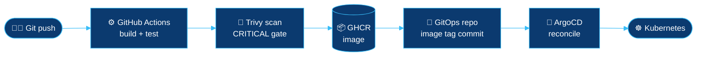
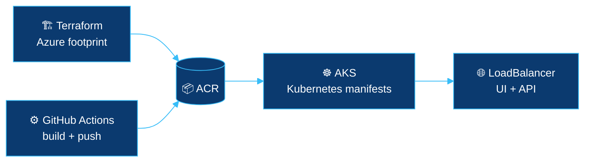
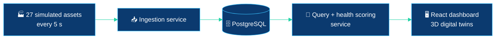
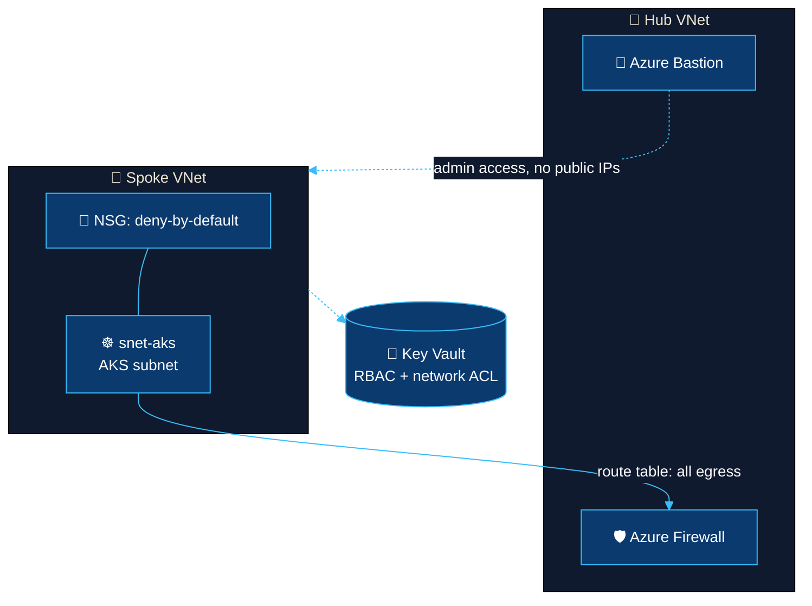

<div align="center">


<a href="https://github.com/aniket-devop">
  
</a>

<br/>

[](https://linkedin.com/in/aniket484)
[](mailto:aniketkmr484@gmail.com)
[](#-featured-projects)
[](#-lets-connect)


<br/><br/>

**[About](#-about-me)** · **[Journey](#-career-journey)** · **[How I Ship](#-how-i-ship)** · **[Stack](#-tech-stack)** · **[Projects](#-featured-projects)** · **[Stats](#-github-stats)** · **[Contact](#-lets-connect)**

<br/>

| 🧑‍💻 Experience | ☁️ Primary Cloud | 🏗️ IaC | ☸️ Orchestration | 📍 Based in |
|:---:|:---:|:---:|:---:|:---:|
| **2 Years** | **Azure** | **Terraform** | **Kubernetes / AKS** | **Bengaluru, India** |

</div>

<br/>

> [!IMPORTANT]
> ### ⚡ Recruiter TL;DR (30 seconds)
> 🟢 **Open to DevOps / Cloud Engineer roles** · full-time · Bengaluru or remote
>
> | What | Proof |
> |---|---|
> | ☸️ **Ships to Kubernetes** | [Live AKS platform](#-axion-intelligence-platform--live-on-aks), built end-to-end: Terraform → ACR → AKS |
> | 🔄 **GitOps, not click-ops** | ArgoCD reconciles from Git. CI never touches the cluster. Rollback = `git revert` |
> | 🔐 **Security built in** | Trivy gate, deny-by-default NSGs, RBAC scoped to the resource group |
> | 📚 **Honest engineering** | Every repo documents its scope, gaps and roadmap |

---

## 🧑‍💻 About Me

I'm a DevOps Engineer with **2 years of hands-on experience** across Azure infrastructure, Terraform, CI/CD automation, containerized deployments and DevSecOps. My day job is Azure and pipelines. My own time goes into projects I build to actually *run*, not just to demo, because I'd rather find out where a design breaks on my own dime than on a client's.

```yaml
aniket:
  role: DevOps Engineer @ DevOps Insiders
  currently_building: [Azure/AKS platform projects, GitOps pipelines with ArgoCD]
  daily_drivers: [Terraform, AKS, Helm, GitHub Actions, Azure DevOps]
  ask_me_about: [Terraform module design, AKS networking, GitOps patterns]
  education: BCA, Chandigarh Group of Colleges, Mohali
  open_to_work: true
```

---

## 🛤️ Career Journey

| When | Role | What I did |
|:---:|---|---|
| **Nov 2024 → Now** | **DevOps Engineer** · DevOps Insiders | Azure infrastructure with Terraform (resource groups, VNets, AKS), CI/CD in GitHub Actions and Azure DevOps, Helm deployments, Prometheus/Grafana monitoring, DevSecOps scanning |
| **Aug 2023 → Oct 2024** | **DevOps & Cloud Engineer** · Freelance client projects | Airflow on Docker Compose + PostgreSQL, StatsD → Prometheus → Grafana monitoring, Terraform and shell deployment scripts |

<details>
<summary><b>💼 Day-to-day responsibilities at DevOps Insiders (click to expand)</b></summary>
<br/>

- Provision and manage Azure infrastructure with Terraform: resource groups, virtual networks and AKS
- Build and maintain CI/CD pipelines in GitHub Actions and Azure DevOps to automate build, test and deployment
- Containerize applications with Docker and deploy to Kubernetes/AKS using Helm charts
- Integrate security and IaC scanning (Trivy, TFLint, TFSec, Checkov) into the delivery lifecycle
- Set up monitoring and observability with Prometheus and Grafana
- Troubleshoot pipeline, infrastructure and deployment issues across environments
- Work with developers and QA to keep release cycles smooth and reliable

</details>

---

## 🧭 How I Work

<table>
<tr>
<td width="33%" valign="top" align="center">

### 🔁 Reproducible
Everything lives in Terraform and YAML. If it can't be rebuilt from code, it isn't done.

</td>
<td width="33%" valign="top" align="center">

### 🔐 Secure by default
Deny-by-default NSGs, RBAC scoped to the resource group, and a Trivy gate before any image ships.

</td>
<td width="33%" valign="top" align="center">

### 📚 Honest engineering
Every project documents its scope, its gaps and its roadmap. No overstated claims.

</td>
</tr>
</table>

---

## 🔄 How I Ship

My GitOps pipeline, end to end (from the [GitOps project](https://github.com/aniket-devop/gitops-kubernetes-config)):



> [!NOTE]
> **CI never touches the cluster.** Deployment and rollback happen through Git alone: a `git revert` on the image-tag commit was enough for ArgoCD to restore the previous version.

---

## 🛠️ Tech Stack

<div align="center">

| | |
|:---|:---|
| **☁️ Cloud & IaC** |  |
| **📦 Containers & GitOps** |    |
| **🚀 CI/CD & Security** |    |
| **📊 Monitoring** |  |
| **💻 Languages & OS** |  |

<sub>🔐 IaC security scanning: TFLint · TFSec · Checkov &nbsp;|&nbsp; ☁️ Azure is my primary cloud; AWS is hands-on project experience.</sub>

</div>

---

## 🏗️ Featured Projects

> [!TIP]
> Every project has an **architecture diagram**, an **honest scope** section and a **roadmap** in its repo README.

### ⭐ Axion Intelligence Platform · live on AKS

27 simulated industrial assets (pumps, motors, compressors) across five refinery sites stream temperature, vibration and current readings every 5 seconds into a dashboard with 3D digital twins and real-time health scoring.


https://github.com/aniket-devop/axion-cloud-infrastructure/raw/main/docs/demo/axion-deployment-demo.mp4

**Delivery path:**



**Runtime:**



- 🧩 Ingestion (write-heavy) and query (aggregation + health scoring) are separate services, so each scales independently
- 🏗️ Terraform `for_each` over an `environments` map renders dev/staging/prod from one module tree
- 🔑 `admin_enabled = false` on ACR, so identity-based auth instead of shared admin credentials

[](https://github.com/aniket-devop/axion-cloud-infrastructure)

<br/>

### 🧰 More Projects

<table>
<tr>
<td width="50%" valign="top">

#### 🔄 GitOps CI/CD Pipeline
CI builds, scans and publishes an image; ArgoCD deploys it.

- 🔒 Trivy `CRITICAL` gate fails the job before GHCR
- 🔒 Non-root container on `python:3.12-alpine`
- 🔄 Rollback is a pure `git revert`


**[App repo](https://github.com/aniket-devop/gitops-ci-pipeline) · [GitOps repo](https://github.com/aniket-devop/gitops-kubernetes-config)**

</td>
<td width="50%" valign="top">

#### 🔐 Azure Network Foundation
Hub-and-spoke network built with Terraform.

- 🛡️ Firewall-forced egress via route table
- 🚫 Bastion instead of a jump box, no VM has a public IP
- 🔑 RBAC scoped to the resource group, not the subscription


**[View repo](https://github.com/aniket-devop/azure-network-foundation-terraform)**

</td>
</tr>
<tr>
<td width="50%" valign="top">

#### 🌱 AWS Landing Network
The same private-compute pattern, rebuilt on AWS.

- 🌐 Multi-AZ VPC, ALB in front of private EC2
- 📤 Outbound-only access through NAT Gateway
- 🔒 Remote state in S3 with DynamoDB locking


**[View repo](https://github.com/aniket-devop/aws-terraform-landing-zone-project)**

</td>
<td width="50%" valign="top">

#### 📊 Airflow Observability Pipeline
Freelance client project, containerized and monitored.

- 🔧 Re-architected to LocalExecutor + PostgreSQL
- 📈 StatsD → Prometheus → Grafana metrics pipeline
- ⚡ Whole stack starts with one `docker compose up`


**[View repo](https://github.com/aniket-devop/airflow-docker-grafana-monitoring)**

</td>
</tr>
</table>

<details>
<summary><b>🔐 See the Azure network design (click to expand)</b></summary>
<br/>



</details>

---

## 🗺️ Currently Learning & Roadmap

| Status | Focus |
|:---:|---|
| 🔨 **Building** | More AKS + GitOps patterns, ArgoCD with multi-environment promotion |
| 📖 **Exploring** | Policy-as-code, deeper Kubernetes security, observability on AKS |
| 🎯 **Next** | Cloud certifications and larger production-style platform projects |

---

## 🔥 GitHub Stats

<div align="center">


<br/><br/>


<br/><br/>


</div>

---

## 📬 Let's Connect

Hiring for a DevOps / Cloud role, or want to talk Terraform, AKS or GitOps? **I read every message.**

<div align="center">

[](https://linkedin.com/in/aniket484)
[](mailto:aniketkmr484@gmail.com)

<br/>

⭐ *If something here helped you, a star on my repos means a lot.*

**Thanks for visiting 💙**


</div>
