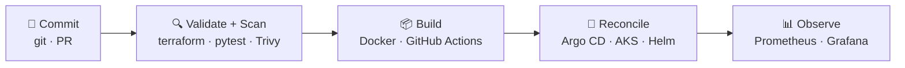

<div align="center">

# Aniket Kumar

<a href="https://github.com/aniket-devop">
  
</a>

<br/>

[](https://linkedin.com/in/aniket484)
[](https://github.com/aniket-devop)


<br/>

| ☁️ **2 clouds** | 🏗️ **5 real projects** | 🔁 **Git-only rollback** | 📡 **27 assets streaming live** |
|:---:|:---:|:---:|:---:|
| Azure (primary) + AWS | Terraform · K8s · GitOps | Verified with ArgoCD | Running on AKS |

</div>

<br/>

## 👋 About

DevOps Engineer with 2 years of hands-on experience in Azure infrastructure, Terraform, CI/CD, Kubernetes, and DevSecOps. At **DevOps Insiders** I work on Azure provisioning and pipeline automation.

On my own time I build things that actually run: a live AKS platform, a GitOps pipeline with Git-only rollback, a hub-and-spoke Azure network. I'd rather find where a design breaks on my own dime than on a client's.

> [!NOTE]
> Every project below states its limits openly. Gaps are in each repo's roadmap, not hidden.

📍 Bengaluru, India &nbsp;·&nbsp; 🎓 BCA, Chandigarh Group of Colleges

<br/>

## 🔄 How I Ship



<br/>

## 🧰 Tech Stack

**☁️ Cloud &amp; IaC**<br/>
 &nbsp;<sub>Azure is primary, AWS is project-level</sub>

**📦 Containers &amp; Orchestration**<br/>


**🔁 CI/CD &amp; GitOps**<br/>


**🔐 DevSecOps**<br/>


**📊 Observability**<br/>


**🐧 Systems &amp; Code**<br/>


<br/>

## 🏗️ Featured Projects

### ⭐ 1 · Axion Intelligence Platform
**Terraform → ACR → AKS, end to end, serving real traffic.**

<a href="https://github.com/aniket-devop/axion-cloud-infrastructure/blob/main/docs/demo/axion-deployment-demo.mp4">

</a>
<br/><sub>▶ Click the screenshot to watch the deployment walkthrough</sub>

27 simulated industrial assets stream telemetry every 5 seconds into a live dashboard with 3D digital twins and real-time health scoring. Terraform provisions Azure, GitHub Actions builds images into ACR, and Kubernetes manifests roll the workloads onto AKS.

<details>
<summary><b>⚙️ Key engineering decisions</b></summary>
<br/>

- Terraform `for_each` over an `environments` map: one module tree renders dev, staging, and prod
- Remote state bootstrapped from a separate `state-infrastructure/` stack
- ACR `admin_enabled = false`: identity-based auth only
- Ingestion and query split into separate services so each scales on its own
- Path-filtered image builds: a frontend commit doesn't rebuild the backend

**Honest scope:** Terraform workflow is plan-only; DB credentials are inline. Key Vault, PVC, and Ingress/TLS are on the roadmap.
</details>


**[View repository →](https://github.com/aniket-devop/axion-cloud-infrastructure)**

<br/>

---

### 🔁 2 · GitOps CI/CD Pipeline
**CI builds and scans. Argo CD deploys. CI never touches the cluster.**

<a href="https://github.com/aniket-devop/gitops-kubernetes-config">

</a>

A two-repo GitOps setup. One repo owns the FastAPI app and its pipeline; the other owns the desired cluster state that Argo CD reconciles.

<details>
<summary><b>⚙️ Key engineering decisions</b></summary>
<br/>

- Trivy `CRITICAL` gate hard-fails the build before an image reaches GHCR
- Two separately scoped tokens, so GitHub Actions never holds cluster credentials
- Argo CD with `automated`, `prune`, and `selfHeal`
- **Rollback is a `git revert`**: no `kubectl rollout undo`, no Argo CD CLI
- Non-root container on `python:3.12-alpine`

**Honest scope:** runs on a local Kind cluster; only `dev` is fully automated.
</details>


**[App repo →](https://github.com/aniket-devop/gitops-ci-pipeline)** &nbsp;·&nbsp; **[GitOps repo →](https://github.com/aniket-devop/gitops-kubernetes-config)**

<br/>

---

### 🛡️ 3 · Azure Terraform Network Foundation
**Hub-and-spoke, deny-by-default, no public IPs on compute.**

<a href="https://github.com/aniket-devop/azure-network-foundation-terraform">

</a>

A hub VNet (Firewall and Bastion), a spoke VNet with a deny-by-default NSG and an AKS-ready subnet, and an RBAC-authorized Key Vault. Deployable to `dev` and `prod` from one Terraform configuration.

<details>
<summary><b>⚙️ Key engineering decisions</b></summary>
<br/>

- Route table forces AKS egress through the Firewall, so its rules are actually enforced
- RBAC scoped to the resource group, not the subscription, to limit blast radius
- Explicit `DenyAllInbound` instead of relying on platform defaults
- Azure Bastion instead of a jump box
- Key Vault via RBAC and network ACL: a documented trade-off against Private Endpoint

**Honest scope:** sandbox-scale, not a full landing zone. CI runs `fmt`, `init`, and `validate` only.
</details>


**[View repository →](https://github.com/aniket-devop/azure-network-foundation-terraform)**

<br/>

---

### 🧪 4 · More Builds

<table>
<tr>
<td width="50%" valign="top">

**☁️ AWS Landing Network**<br/>
<sub>Terraform · VPC · ALB · EC2 · S3 · DynamoDB</sub>

<a href="https://github.com/aniket-devop/aws-terraform-landing-zone-project">

</a>

The Azure private-compute pattern, rebuilt on AWS. Multi-AZ VPC, ALB-fronted EC2 in private subnets, outbound via NAT, and remote state in S3 with DynamoDB locking. Every PR runs `fmt`, `validate`, and `plan`.

**[View repository →](https://github.com/aniket-devop/aws-terraform-landing-zone-project)**

</td>
<td width="50%" valign="top">

**📊 Airflow Observability Pipeline**<br/>
<sub>Docker Compose · Airflow · StatsD · Prometheus · Grafana</sub>

<a href="https://github.com/aniket-devop/airflow-docker-grafana-monitoring">

</a>

Client project. I re-architected Airflow's Celery/Redis setup into a single-node `LocalExecutor` deployment, dropping a broker and worker fleet that added nothing at that scale, then wired StatsD → Prometheus → Grafana. One `docker compose up`.

**[View repository →](https://github.com/aniket-devop/airflow-docker-grafana-monitoring)**

</td>
</tr>
</table>

<br/>

## 📈 GitHub Activity

<div align="center">


<br/><br/>


<br/><br/>


</div>

<br/>

<table>
<tr>
<td width="50%" valign="top">

```yaml
# 🧠 how I think
principles:
  - If it's not in Git, it doesn't exist
  - Shift security left, scan before you ship
  - A rollback you haven't tested is a hope
  - You can't fix what you can't observe
currently:
  building: AKS platform + GitOps
  learning: Platform engineering, SRE
```

</td>
<td width="50%" valign="top">

```text
# 🎯 what you get when you hire me
✔ Infra that is reproducible, not clicked
✔ Pipelines that scan before they ship
✔ Rollbacks that are one git revert away
✔ Dashboards before incidents, not after
✔ Honest docs: limits stated upfront
✔ Immediate joiner
```

</td>
</tr>
</table>

<br/>

## 📬 Let's Talk

I'm open to **DevOps / Cloud Engineer** roles, full-time, in Bengaluru or remote. If something here matches what you're hiring for, or you want to compare notes on Terraform module design, AKS networking, or GitOps patterns, message me.

<div align="center">

[](https://linkedin.com/in/aniket484)

<!-- Optional: add your email as a clickable badge
[](mailto:YOUR_EMAIL_HERE)
-->

</div>
