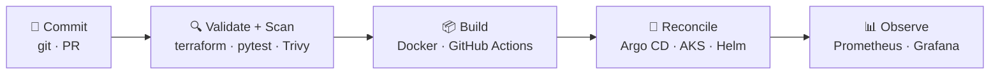
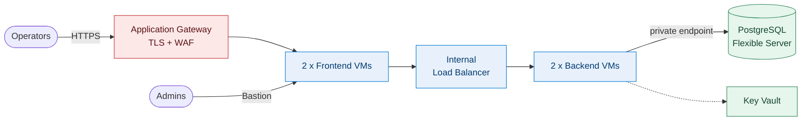

# Aniket Kumar

 

&nbsp;&nbsp;&nbsp;

&nbsp;&nbsp;&nbsp;

<a href="https://medium.com/@aniketkmr484"><b>Medium</b></a>

 

| ☁️ **2 clouds** | 🏗️ **6 real projects** | 🔁 **Git-only rollback** | 📡 **27 assets streaming live** |
|:---:|:---:|:---:|:---:|
| Azure (primary) + AWS | Terraform · K8s · GitOps | Verified with ArgoCD | Running on AKS |

 

## 👋 About

DevOps Engineer with 2 years of hands-on experience in Azure infrastructure, Terraform, CI/CD, Kubernetes, and DevSecOps. At **DevOps Insiders** I work on Azure provisioning and pipeline automation.

On my own time I build things that actually run: a live AKS platform, a GitOps pipeline with Git-only rollback, a hub-and-spoke Azure network. I'd rather find where a design breaks on my own dime than on a client's.

> [!NOTE]
> Every project below states its limits openly. Gaps are in each repo's roadmap, not hidden.

📍 Bengaluru, India &nbsp;·&nbsp; 🎓 BCA, Chandigarh Group of Colleges

 

## 💼 Experience

**DevOps Engineer** · DevOps Insiders &nbsp;|&nbsp; Nov 2024 – Present 
Industrial IoT monitoring application for a UK-based refinery client

- Built and maintained 6+ CI/CD pipelines on Azure DevOps and GitHub Actions across Dev, QA and Staging
- Provisioned Azure infrastructure with reusable Terraform modules and remote state; added 4 automated checks (fmt/validate, TFLint, tfsec, Checkov) to CI/CD
- Deployed containerized services on AKS with Docker and Helm; built Prometheus and Grafana dashboards for application, pod and infrastructure health

**DevOps Engineer** · Freelance &nbsp;|&nbsp; Jul 2026 – Aug 2026 
Airflow Observability Pipeline

- Delivered a single-node Apache Airflow setup on Docker Compose (8 services), migrating from CeleryExecutor + Redis to LocalExecutor + PostgreSQL
- Built Airflow-to-Grafana monitoring with StatsD, Prometheus and Grafana, and verified ~129 airflow_* metrics

 
## 🔄 How I Ship

 

## Tech Stack

<table>
<tr>
<td width="170"><b>Cloud &amp; IaC</b></td>
<td align="center" width="100"> Azure</td>
<td align="center" width="100"> AWS</td>
<td align="center" width="100"> Terraform</td>
<td></td><td></td><td></td>
</tr>
<tr>
<td><b>Containers</b></td>
<td align="center"> Docker</td>
<td align="center"> Kubernetes</td>
<td align="center"> Helm</td>
<td></td><td></td><td></td>
</tr>
<tr>
<td><b>CI/CD &amp; GitOps</b></td>
<td align="center"> GitHub Actions</td>
<td align="center"> Azure DevOps</td>
<td align="center"> Argo CD</td>
<td></td><td></td><td></td>
</tr>
<tr>
<td><b>Observability</b></td>
<td align="center"> Prometheus</td>
<td align="center"> Grafana</td>
<td></td><td></td><td></td><td></td>
</tr>
<tr>
<td><b>Systems &amp; Code</b></td>
<td align="center"> Linux</td>
<td align="center"> Bash</td>
<td align="center"> Python</td>
<td align="center"> FastAPI</td>
<td align="center"> PostgreSQL</td>
<td align="center"> Git</td>
</tr>
<tr>
<td><b>DevSecOps</b></td>
<td colspan="6"><code>Trivy</code> &nbsp; <code>tfsec</code> &nbsp; <code>TFLint</code> &nbsp; <code>Checkov</code> &nbsp; <code>SonarQube</code> &nbsp; <code>Infracost</code></td>
</tr>
</table>

Azure is my primary cloud (AKS in production work); AWS at project level.

 
## 🏗️ Featured Projects

### ⭐ 1 · Axion Intelligence Platform
**Terraform → ACR → AKS, end to end, serving real traffic.**

 ▶ Click the screenshot to watch the deployment walkthrough

27 simulated industrial assets stream telemetry every 5 seconds into a live dashboard with 3D digital twins and real-time health scoring. Terraform provisions Azure, GitHub Actions builds images into ACR, and Kubernetes manifests roll the workloads onto AKS.

<b>⚙️ Key engineering decisions</b>

 

- Terraform `for_each` over an `environments` map: one module tree renders dev, staging, and prod
- Remote state bootstrapped from a separate `state-infrastructure/` stack
- ACR `admin_enabled = false`: identity-based auth only
- Ingestion and query split into separate services so each scales on its own
- Path-filtered image builds: a frontend commit doesn't rebuild the backend

**Honest scope:** Terraform workflow is plan-only; DB credentials are inline. Key Vault, PVC, and Ingress/TLS are on the roadmap.

**[View repository →](https://github.com/aniket-devop/axion-cloud-infrastructure)**

 

---

### 🛡️ 2 · Azure Landing Zone & DevSecOps
**Every release scanned, costed, reviewed and approved before it reaches Prod.**

A three-tier Azure platform for an Industrial IoT monitoring system in petroleum refineries. I designed the Landing Zone with modular Terraform and built the Azure DevOps pipelines that ship infrastructure and application (frontend, backend, database) through Dev, Test and Prod with manual approval gates.

<b>⚙️ Key engineering decisions</b>

 

- `terraform validate`, tfsec, TFLint and Infracost all run before apply, then plan review and manual approval
- Infrastructure and application CI/CD are separate, so neither waits on the other
- Build once, promote the same artifact through Dev → Test → Prod with approval gates
- Private endpoints for PostgreSQL, Azure Bastion for admin access, Key Vault for secrets
- Liquibase for versioned database migrations, with SonarQube quality checks on application code

**Honest scope:** the application code was written by the wider dev team; this repo covers the platform and delivery pipelines.

**[View repository →](https://github.com/aniket-devop/azure-landing-zone-devsecops)**

 

---

### 🔁 3 · GitOps CI/CD Pipeline
**CI builds and scans. Argo CD deploys. CI never touches the cluster.**

A two-repo GitOps setup. One repo owns the FastAPI app and its pipeline; the other owns the desired cluster state that Argo CD reconciles.

<b>⚙️ Key engineering decisions</b>

 

- Trivy `CRITICAL` gate hard-fails the build before an image reaches GHCR
- Two separately scoped tokens, so GitHub Actions never holds cluster credentials
- Argo CD with `automated`, `prune`, and `selfHeal`
- **Rollback is a `git revert`**: no `kubectl rollout undo`, no Argo CD CLI
- Non-root container on `python:3.12-alpine`

**Honest scope:** runs on a local Kind cluster; only `dev` is fully automated.

**[App repo →](https://github.com/aniket-devop/gitops-ci-pipeline)** &nbsp;·&nbsp; **[GitOps repo →](https://github.com/aniket-devop/gitops-kubernetes-config)**

 

---

### 🛡️ 4 · Azure Terraform Network Foundation
**Hub-and-spoke, deny-by-default, no public IPs on compute.**

A hub VNet (Firewall and Bastion), a spoke VNet with a deny-by-default NSG and an AKS-ready subnet, and an RBAC-authorized Key Vault. Deployable to `dev` and `prod` from one Terraform configuration.

<b>⚙️ Key engineering decisions</b>

 

- Route table forces AKS egress through the Firewall, so its rules are actually enforced
- RBAC scoped to the resource group, not the subscription, to limit blast radius
- Explicit `DenyAllInbound` instead of relying on platform defaults
- Azure Bastion instead of a jump box
- Key Vault via RBAC and network ACL: a documented trade-off against Private Endpoint

**Honest scope:** sandbox-scale, not a full landing zone. CI runs `fmt`, `init`, and `validate` only.

**[View repository →](https://github.com/aniket-devop/azure-network-foundation-terraform)**

 

---

### 🧪 5 · More Builds

<table>
<tr>
<td width="50%" valign="top">

**☁️ AWS Landing Network** 
Terraform · VPC · ALB · EC2 · S3 · DynamoDB

The Azure private-compute pattern, rebuilt on AWS. Multi-AZ VPC, ALB-fronted EC2 in private subnets, outbound via NAT, and remote state in S3 with DynamoDB locking. Every PR runs `fmt`, `validate`, and `plan`.

**[View repository →](https://github.com/aniket-devop/aws-terraform-landing-zone-project)**

</td>
<td width="50%" valign="top">

**📊 Airflow Observability Pipeline** 
Docker Compose · Airflow · StatsD · Prometheus · Grafana

Client project. I re-architected Airflow's Celery/Redis setup into a single-node `LocalExecutor` deployment, dropping a broker and worker fleet that added nothing at that scale, then wired StatsD → Prometheus → Grafana. One `docker compose up`.

**[View repository →](https://github.com/aniket-devop/airflow-docker-grafana-monitoring)**

</td>
</tr>
</table>

 

## 📈 GitHub Activity

 

<h3><i>"If it's not in Git, it doesn't exist."</i></h3>

Automate &nbsp;·&nbsp; Secure &nbsp;·&nbsp; Observe &nbsp;·&nbsp; Repeat

 

## What I Bring

<table>
<tr>
<td align="center" width="33%">
  
<b>Reproducible infrastructure</b> 
Modular Terraform with remote state, no manual console changes
</td>
<td align="center" width="33%">
  
<b>Pipelines with security gates</b> 
Trivy, tfsec and Checkov run before anything ships
</td>
<td align="center" width="33%">
  
<b>Git-based rollbacks</b> 
Argo CD reconciles from Git, rollback is a <code>git revert</code>
</td>
</tr>
<tr>
<td align="center">
  
<b>Kubernetes delivery</b> 
AKS deployments with Docker and Helm
</td>
<td align="center">
  
<b>Observability</b> 
Prometheus and Grafana dashboards for apps, pods and infrastructure
</td>
<td align="center">
  
<b>Azure-first cloud</b> 
Landing zones, hub-and-spoke networking, AWS at project level
</td>
</tr>
</table>

 

## Let's Talk

 

Happy to compare notes on Terraform module design, AKS networking, or GitOps patterns.

 

  

 

