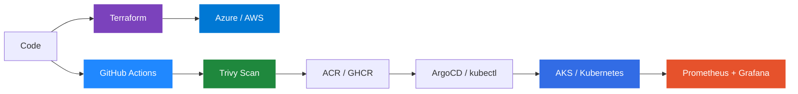

<div align="center">

# Aniket Kumar

**DevOps Engineer** · Azure · Terraform · Kubernetes · GitOps · DevSecOps

<br>


<br><br>

[](#-deployments)
[](https://linkedin.com/in/aniket484)

</div>

<br>

```yaml
$ whoami
aniket-kumar

$ cat profile.yml
role:        DevOps Engineer @ DevOps Insiders
experience:  2 years
location:    Bengaluru, India
cloud:       [Azure (primary), AWS]
iac:         Terraform
ships_with:  [GitHub Actions, Azure DevOps, Docker, Helm, ArgoCD]
runs_on:     [AKS, Kubernetes]
secures_with: [Trivy, TFLint, TFSec, Checkov]
observes_with: [Prometheus, Grafana]
motto:       "I make infrastructure boring in the right way."
status:      open to DevOps / Cloud Engineer roles (Bengaluru | remote)
```

> No manual clicks. No "it works on my machine." Everything reproducible, everything in code.

---

## ⚙️ How I Ship



<sub>Every stage above is something I have built in the projects below.</sub>

---

## 🚀 Deployments

| | Project | Platform | Stack |
|:-:|---|---|---|
| ⭐ | [**Axion Intelligence Platform**](#-axion-intelligence-platform) | Azure AKS | Terraform · GitHub Actions · FastAPI · React |
| 🔁 | [**GitOps CI/CD Pipeline**](#-gitops-cicd-pipeline) | Kind (local) | Trivy · GHCR · Helm · ArgoCD |
| 🛡️ | [**Azure Network Foundation**](#-azure-network-foundation) | Azure | Terraform · Firewall · Bastion · Key Vault |
| ☁️ | [**AWS Landing Network**](#-aws-landing-network) | AWS | Terraform · VPC · ALB · S3 · DynamoDB |
| 📈 | [**Airflow Observability**](#-airflow-observability-pipeline) | Docker Compose | Airflow · Prometheus · Grafana |

<br>

### ⭐ Axion Intelligence Platform

```yaml
repo:      axion-cloud-infrastructure
platform:  Azure AKS + ACR
iac:       Terraform
pipeline:  GitHub Actions
app:       FastAPI + React + PostgreSQL
flow:      Terraform → GitHub Actions → ACR → AKS → LoadBalancer
scope:     portfolio build, gaps documented in repo roadmap
```

**An industrial IoT monitoring platform running on a live AKS cluster.** 27 simulated assets (pumps, motors, compressors) across five refinery sites stream temperature, vibration, and current readings every 5 seconds into a dashboard with 3D digital twins and real-time health scoring.

<p align="center">
  <a href="https://raw.githubusercontent.com/aniket-devop/axion-cloud-infrastructure/main/docs/architecture.png">
    
  </a>
</p>

- Ingestion and query split into separate services so each scales independently
- One Terraform module tree renders dev/staging/prod through `for_each` over an `environments` map
- Remote state bootstrapped in a separate stack; ACR runs with `admin_enabled = false`

**[Repository →](https://github.com/aniket-devop/axion-cloud-infrastructure)** · **[Watch the demo →](https://github.com/aniket-devop/axion-cloud-infrastructure/raw/main/docs/demo/axion-deployment-demo.mp4)**

<br>

### 🔁 GitOps CI/CD Pipeline

```yaml
repos:     gitops-ci-pipeline + gitops-kubernetes-config
runs_on:   Kind (local cluster)
app:       FastAPI, non-root container on python:3.12-alpine
flow:      pytest → Docker build → Trivy CRITICAL → GHCR → Git commit → ArgoCD → Kind
rollback:  git revert, ArgoCD selfHeal reconciles
scope:     only dev is fully automated; staging is manual sync
```

**Two repos, one boundary: CI never touches the cluster.** The app repo builds, tests, scans, and publishes an image. The config repo holds the desired state that ArgoCD reconciles.

<p align="center">
  <a href="https://raw.githubusercontent.com/aniket-devop/gitops-kubernetes-config/main/screenshots/architecture-diagram.png">
    
  </a>
</p>

- Trivy CRITICAL gate hard-fails the pipeline before an image reaches GHCR
- Two separately scoped credentials, so neither can touch the cluster directly

**[App repo →](https://github.com/aniket-devop/gitops-ci-pipeline)** · **[GitOps repo →](https://github.com/aniket-devop/gitops-kubernetes-config)**

<br>

### 🛡️ Azure Network Foundation

```yaml
repo:      azure-network-foundation-terraform
platform:  Azure
iac:       Terraform (dev + prod from one configuration)
topology:  Hub VNet (Firewall + Bastion) → Spoke VNet (NSG + AKS subnet) → Key Vault
ci:        terraform fmt, init, validate
scope:     sandbox-scale, not a full Cloud Adoption Framework landing zone
```

**A hub-and-spoke Azure network built entirely in Terraform**, with egress forced through the Firewall and an RBAC-authorized Key Vault.

<p align="center">
  <a href="https://raw.githubusercontent.com/aniket-devop/azure-network-foundation-terraform/main/diagrams/architecture.png">
    
  </a>
</p>

- RBAC scoped to the resource group, not the subscription, to limit blast radius
- Explicit `DenyAllInbound` rule instead of relying on platform defaults
- Bastion instead of a jump box, so no VM carries a public IP

**[Repository →](https://github.com/aniket-devop/azure-network-foundation-terraform)**

<br>

### ☁️ AWS Landing Network

```yaml
repo:      aws-terraform-landing-zone-project
platform:  AWS, one VPC across two AZs
iac:       Terraform, remote state in S3 with DynamoDB locking
traffic:   Internet → ALB (public) → EC2 (private) → NAT Gateway
ci:        fmt -check → validate → plan on every PR
scope:     self-driven hands-on project
```

**The same private-compute pattern as the Azure project, rebuilt in AWS.** EC2 security groups accept traffic only from the ALB.

<p align="center">
  <a href="https://raw.githubusercontent.com/aniket-devop/aws-terraform-landing-zone-project/main/diagrams/architecture.png">
    
  </a>
</p>

**[Repository →](https://github.com/aniket-devop/aws-terraform-landing-zone-project)**

<br>

### 📈 Airflow Observability Pipeline

```yaml
repo:      airflow-docker-grafana-monitoring
origin:    freelance client project
runs_on:   Docker Compose, single node
executor:  LocalExecutor + PostgreSQL (replaced CeleryExecutor/Redis)
metrics:   Airflow → StatsD Exporter → Prometheus (15s scrape) → Grafana
scope:     working single-node deployment, no pre-provisioned dashboards or alerting
```

**Re-architected from Airflow's official template**, dropping the message broker and worker fleet that add no value at single-node scale.

<p align="center">
  <a href="https://raw.githubusercontent.com/aniket-devop/airflow-docker-grafana-monitoring/main/assets/architecture-diagram.png">
    
  </a>
</p>

**[Repository →](https://github.com/aniket-devop/airflow-docker-grafana-monitoring)**

---

## 💼 Experience

```yaml
role:     DevOps Engineer
company:  DevOps Insiders
does:
  - Provisions and manages Azure infrastructure with Terraform (resource groups, VNets, AKS)
  - Builds CI/CD pipelines with GitHub Actions and Azure DevOps Pipelines
  - Containerizes applications and deploys to Kubernetes/AKS using Helm
  - Applies DevSecOps by integrating security and IaC scanning into delivery
  - Sets up monitoring with Prometheus and Grafana
  - Troubleshoots pipeline, infrastructure, and deployment issues across environments
```

**Education:** BCA, Chandigarh Group of Colleges, Mohali

---

## 📬 Let's Talk

```yaml
status:   open to DevOps / Cloud Engineer roles
type:     full-time
where:    Bengaluru or remote
topics:   Terraform module design, AKS networking, GitOps patterns
```

<div align="center">

[](https://linkedin.com/in/aniket484)

</div>
